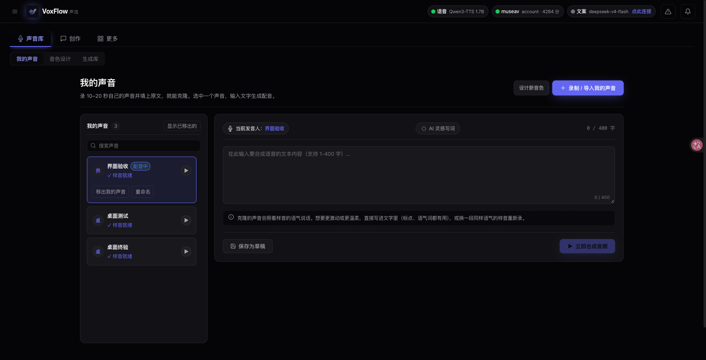
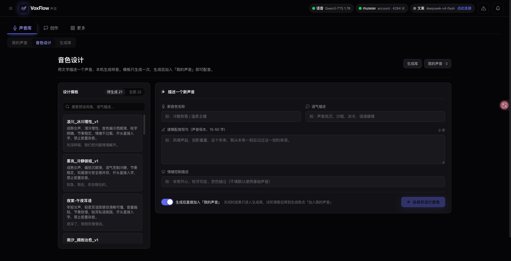
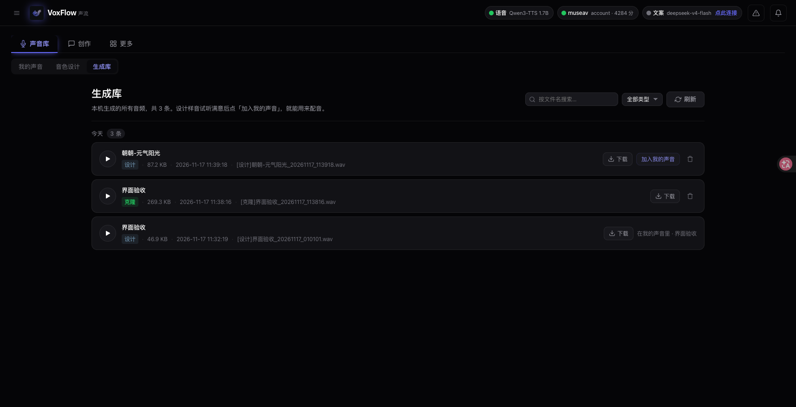

<p align="center">
  <picture><source media="(prefers-color-scheme: dark)" srcset="https://cdn.jsdelivr.net/gh/webkubor/free-imgbed@main/voxflow/mark-v3-dark.svg"></picture>
</p>

<h1 align="center">VoxFlow 声流</h1>

<p align="center">
  
  
  
  
  
</p>

<p align="center">
  <b>在 Mac 上录一段自己的声音，就能用它朗读任何文字。</b><br />
  声音克隆、文字设计音色、多角色剧本演播，全部在本机运行 —— 音频不上传，不需要商业 API Key。
</p>

<p align="center">
  <a href="#五分钟上手">五分钟上手</a> ·
  <a href="#界面里有什么">界面导览</a> ·
  <a href="#声音怎么管理">声音管理规则</a> ·
  <a href="#命令行">命令行</a> ·
  <a href="#给-agent-用">给 Agent 用</a>
</p>

<p align="center">
  
</p>

---

## 你可以用它做什么

| 想做的事 | 在哪里做 | 需要准备 |
|---|---|---|
| **用自己的声音配音** | 「我的声音」→ 录制 / 导入我的声音 → 输入文字生成 | 一段 10–20 秒的录音，以及录音里说的原文 |
| **用文字描述做一个新声音** | 「音色设计」→ 选模板或自己写描述 → 生成 | 一句描述，例如「沉稳的中年男声，语速偏慢」 |
| **多个角色演一段剧本** | 「剧本演播」 | 已有的几个声音 + 台词 |

所有生成都在本机完成。克隆、设计、配音用的是本地模型，**不花钱**；
只有可选的 AI 写文案、封面出图会用你自己 museav 账户的积分，用之前会单独授权。

---

## 五分钟上手

**环境要求：** Apple Silicon（M 系列）Mac，macOS，Python 3.10+，约 6 GB 磁盘空间放模型。

```bash
git clone git@github.com:webkubor/voxflow.git
cd voxflow
./install.sh --skip-models      # 先装依赖，约 2 分钟；模型稍后在界面里下载
source .venv/bin/activate
voice web                       # 打开 http://localhost:8866
```

然后：

1. **下载模型。** 第一次打开「我的声音」会提示下载 Base 模型（2.9 GB），点一下就在后台下载，关掉页面也不会中断。
   想用「音色设计」时再下 VoiceDesign 模型（2.9 GB）。
2. **录你的声音。** 点「录制 / 导入我的声音」，先写好要念的一段话，再点录音，用正常语速念完。
   **原文必须和录音逐字一致** —— 克隆质量主要取决于这一步。建议 10–20 秒、安静环境，最长 30 秒。
3. **配第一句。** 在左侧选中刚录的声音，右边输入文字，点「立即合成音频」。生成完会自动播放，文件同时出现在「生成库」。

想要原生窗口，可以装桌面 App（见[下文](#macos-桌面-app)），功能和数据与网页版完全相同。

> 模型下载到 `~/.voxflow/models-mlx/`，你的声音、生成的音频也都在 `~/.voxflow/`。
> 重装、换分支、删掉项目目录都不会丢数据，也不用重新下载模型。

---

## 界面里有什么

顶部两组导航，一次只看三个入口：

| 分组 | 页面 | 用来做什么 |
|---|---|---|
| **声音工坊** | 我的声音 | 录制 / 导入自己的声音；选一个声音，输入文字生成配音 |
| | 音色设计 | 用文字描述生成新声音；内置模板每个只生成一次，生成过的会标「已生成」并可直接试听 |
| | 剧本演播 | 多个角色、多段台词，一次合成整段对话 |
| **创作与资产** | 原创存证 | 导出创作记录（提示词、参数、选用的版本、音频指纹），用于证明原创 |
| | 生成库 | 所有生成过的音频：试听、下载、把设计样音加入「我的声音」、删除 |
| | 成本与健康 | 用量、花费（本地生成记为 ¥0）、服务状态与运行日志 |

<p align="center">
  
  
</p>

---

## 声音怎么管理

两个地方，分工不同：

- **我的声音**：能直接拿来配音的声音。你录的声音注册后自动在这里；音色设计的结果默认也直接加入这里。
- **生成库**：所有生成出来的音频文件，包括配音结果和设计样音。设计时如果关掉了「生成后直接加入我的声音」，可以先在这里试听，满意了再点「加入我的声音」。

规则：

- **模板只生成一次。** 已生成或正在生成的模板不能再次提交，避免重复占用时间；想要不同效果，就写一份新的描述。
- **收藏、重命名随时可改。** 重命名只改显示名，不动音频文件。
- **删除需要确认。** 删除前会说明影响：声音会从「我的声音」移除，**参考音频文件保留在本机**，不会被删掉。
- **不会覆盖。** 名字重复、同一个样音重复加入，都会提示冲突，已有数据保持原样。

网页、桌面 App、命令行共用同一套规则（`core/voice_library.py`）和同一份数据。

---

## 命令行

所有界面能做的事，命令行都能做：

```bash
# 我的声音
voice voice record me --ref-text "要朗读的原文" --seconds 15     # 麦克风录音并注册（终端需麦克风权限）
voice voice add me sample.wav --ref-text "录音里说的原文"          # 用已有录音注册
voice voice list [--favorites]                                   # 列出声音
voice voice rename me "我的旁白"
voice voice preview me                                           # 用一句话试听
voice voice rm me --yes                                          # 删除（参考音频保留）

# 配音
voice clone me "霜叶红于二月花，山色空蒙雨亦奇。"

# 音色设计与模板
voice preset list --pending                                      # 还没生成过的模板
voice preset run <模板名>                                         # 生成；已生成的会被拒绝
voice design 侠客 "十步杀一人，千里不留行。" --tone "苍劲豪迈，沉稳威严" --commit

# 生成库
voice library list --kind design --unsaved                       # 还没加入我的声音的设计样音
voice library save "<文件名>" "新名字"                            # 加入我的声音，不重新生成

# 剧本、环境、用量
voice dialogue configs/dialogue.json
voice doctor                                                     # 环境自检
voice stats                                                      # 近 30 天用量与花费
```

> **克隆时 `--tone` / `--emotion` 不生效。** 当前 MLX 版 Base 模型没有情绪指令入口。
> 想要情绪，就把它写进文本（「他压低声音说：……」），或用音色设计生成一个带情绪的新声音。
> CLI 遇到这种情况会明确提示，不会静默忽略。

---

## 给 Agent 用

`voice voice`、`voice library`、`voice preset`、`voice design`、`voice clone` 都支持 `--json`：

- stdout 只输出一个 JSON 对象：`{"ok": true, ...}` 或 `{"ok": false, "error": "...", "status": 409}`；进度信息走 stderr。
- 退出码：`0` 成功、`1` 错误、`3` 不存在、`4` 冲突（重名、模板已生成或正在生成）。
- 非交互环境里删除必须加 `--yes`，不会卡在确认提示上。

```bash
voice preset list --pending --json | jq -r '.presets[].name'
voice voice rm old_voice --yes --json; echo "exit=$?"
./install.sh --yes                  # 无交互安装：依赖 + 两个模型
voice doctor --json                 # 环境检查结果，供 Agent 判断
```

完整命令清单与约定见 [AGENTS.md](AGENTS.md)。

---

## macOS 桌面 App

基于 MyGo + WKWebView 的原生窗口，界面与网页版相同，共用 `~/.voxflow/` 里的数据。
App 内录音会请求麦克风权限，请在系统弹窗中允许；如果之前拒绝过，到「系统设置 → 隐私与安全性 → 麦克风」重新打开。

```bash
./desktop/build.sh      # 构建并安装到 ~/Applications
```

App 启动时会复用已在运行的本地服务，没有就从项目目录启动。移动项目目录后，重新运行一次构建脚本。

---

## 隐私与花费

- **音频不出本机**：录音、参考音频、生成结果都只存在 `~/.voxflow/`，没有任何上传路径。
- **本地生成免费**：克隆、设计、配音、剧本演播都用本机模型，不计费。
- **可选的付费能力**：AI 写文案 / 润色、封面出图使用你自己的 museav 账户积分，需要先 `voice museav login` 授权；不连接也不影响声音功能。

---

## 技术说明

- **模型**：Qwen3-TTS 1.7B，[mlx-community](https://huggingface.co/mlx-community) 8-bit 量化版，Base（克隆）与 VoiceDesign（设计）各约 2.9 GB。
- **为什么只支持 Apple Silicon**：2026-09 起推理改为 Apple MLX，相比原 PyTorch + MPS 方案体积小 31%、单次推理快约 1.76 倍，并且不再有「算子静默回退 CPU」的问题。PyTorch 链路已移除，`voice doctor` 在非 Apple Silicon 上会直接报 FAIL。
- **参考原文为什么必填**：参考音频没有对应原文时，模型输出会被截断并出现乱码，所以注册时强制填写。
- 迁移数据、音色还原度测试与回滚方法见 [docs/MLX_MIGRATION.md](docs/MLX_MIGRATION.md)。

<details>
<summary>项目结构</summary>

```
voxflow/
├── cli/            # 命令行入口（voice clone / design / voice / library / preset / doctor …）
├── core/
│   ├── voice_library.py  # 我的声音、生成库、模板状态的唯一规则出处（网页与 CLI 共用）
│   ├── paths.py          # 代码目录与数据目录的唯一定义
│   └── engine.py         # Qwen3-TTS（MLX）引擎
├── web/
│   ├── app.py      # FastAPI 后端：合成、声音、任务队列、健康与用量
│   └── ui/         # Vue 3 + Pinia + Naive UI 前端
├── desktop/        # macOS 桌面 App（MyGo）
├── configs/        # 内置设计模板、单价表
├── tests/          # 回归测试
└── docs/           # 文档索引见 docs/README.md
```

</details>

> AI 音乐生成与全网发行已拆到独立项目 [suno-publisher](https://github.com/webkubor/suno-publisher)，本仓只做声音。

## 开源协议

[Apache-2.0](LICENSE)。底层语音模型为 Qwen3-TTS，推理权重来自 [mlx-community](https://huggingface.co/mlx-community)。
